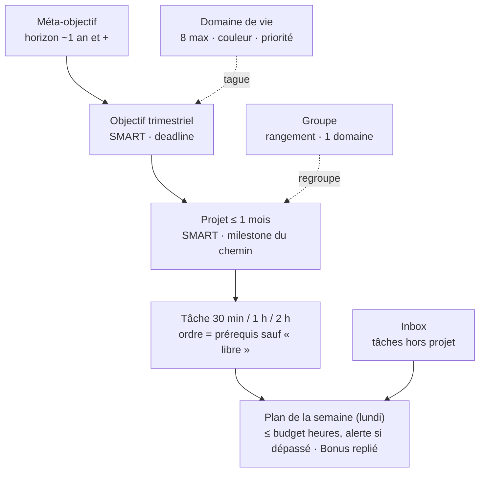

# Mémento — Specs fonctionnelles

Oct 23, 2026 · @Mehdi · v0.1 brouillon

## 1. Vision & objectifs

L'outil pilote la vie de Mehdi autour d'un phare (ses **objectifs**) et le **limite** pour protéger sa charge mentale. Chaque exigence porte un ID (VIS, G, DM, CH, WF, V, F, NF) repris dans la matrice de traçabilité (§10).

**Objectifs produit**

- **VIS-01 — Garder le cap** : rester FOCUS sur ce qui doit être fait et délivrer la meilleure valeur.
- **VIS-02 — Gérer la charge mentale (prioritaire si conflit avec VIS-01)** : savoir ce que je fais, ce que ça puise dans mes réserves, et surtout **ME LIMITER** (tendance à la surcharge qui finit par faire du mal).
- **VIS-03 — Phare = objectifs** : je décide d'un objectif, j'y mappe des projets ; un projet contient un milestone ou est lui-même un milestone ; chaque projet est découpé en tâches.
- **VIS-04 — Cadre évolutif** : la hiérarchie Objectif → Projet → Tâche est un cadre high level, il peut évoluer avec ce document.
- **VIS-05 — Outil unique** : TOUS les projets doivent y vivre. Un projet géré ailleurs = mort assurée de l'outil.
- **VIS-06 — Roadmap agile** : pas de plan figé sur 3 ans. Les objectifs bougent peu, le chemin (projets) s'adapte grâce aux revues et au bornage dans le temps.
- **VIS-07 — Timing** : l'outil doit être prêt AVANT de lancer de nouveaux projets.

* **VIS-13 — Piloté par IA, carnet de bord humain** : l'IA (via MCP/API) crée, découpe, planifie. Moi : je consulte (carnet de bord) et je retouche ponctuellement. Conséquences : API/MCP couvrent 100 % des actions, chaque modif est journalisée (IA ou moi), l'UI est d'abord faite pour lire.

**Philosophie de vie à encoder**

- **VIS-08 — Un seul calendrier, plusieurs domaines de vie** : santé, famille, travail, patrimoine (= finance), loisirs, etc.
- **VIS-09 — Priorités de vie** : 1. Santé (esprit sain dans un corps sain) · 2. Famille (en profiter) · 3. Charge mentale et contrôle des peurs (besoin de contrôle, notamment financier).
- **VIS-10 — But de vie** : sur mon lit de mort, des tonnes de souvenirs, avoir profité et bien vécu. Constat : bosser comme un fou et déployer des dizaines de projets ne laisse pas de trace ; une sortie ou une expérience partagée avec famille/amis laisse une trace indélébile. L'outil doit pousser vers ces expériences.
- **VIS-11 — Anti-dérive** : tendance à se laisser happer par les projets et oublier famille et santé → surveillance de près et rééquilibrage.

**Hors périmètre**

- **VIS-12 — Pas de gestion d'habitudes.** Installer une habitude = un projet (ex. se remettre au sport : trouver un 2e sport, tester, s'inscrire, suivre les cours un trimestre, mesurer le résultat). Une fois acquise, l'habitude sort de l'outil.

**Existant (v1 Vikunja, homelab)** — source d'inspiration, pas à reprendre tel quel :

- Labels durée : \~30min, \~1h, \~2h, \~4h, \~1j.
- Labels « pilier » : S1-Santé, S2-Charge, S3-Famille, S4-Revenus, S5-Sécurité, S6-Esprit.
- Labels nature : Builder, Expérience, Free Mind, Life Style, Loisir, No Regrets, Patrimoine, Pilier, Projet-charge, Santé, Sécurité, Social.
- Arborescence : Job Archi, Patrimoine (Création sociétés, Projet Résilience, Reaper Bot, Immobilier), SaaS, Santé, IA (Menu Planning, Planning Builder…), Homelab & Tech.

## 2. Principes directeurs (« Les Règles d'or »)

Toute fonctionnalité est refusée si elle viole une de ces règles. Titre proposé : **Règles d'or** (titre à valider).

| ID | Règle | Critère vérifiable |
| --- | --- | --- |
| G-01 | **Lire le moins possible** | Aucun écran principal ne montre de paragraphe ; descriptions repliées par défaut |
| G-02 | **Lecture en Z** | Hiérarchie visuelle : gras, mise en évidence, atténuation des éléments secondaires, couleur pour guider l'œil ; la teneur d'un écran se comprend en un regard |
| G-03 | **Minimum de clics** | Créer une tâche ≤ 2 actions ; cocher une tâche = 1 clic |
| G-04 | **Automatiser au maximum** | Rapports, plan hebdo, contrôles de charge générés sans action humaine |
| G-05 | **Multi-écran** | PC écran UltraWide, iPhone 17, iPad 11" — mise en page adaptée à chacun, pas juste « responsive » |
| G-06 | **Données ouvertes** | API (ou autre méthode) pour déposer ET récupérer de la donnée |
| G-07 | **MCP disponible** | Un serveur MCP expose lecture et écriture (piloter l'outil depuis Claude / Yuki) |
| G-08 | **Code couleur par domaine, sobre** | Si Santé = vert, je sais que je suis dans un projet santé parce qu'il y a du vert dans l'ambiance (bandeau, liseré, accent), pas juste un petit tag. Jamais bariolé : dosage fin de la couleur |
| G-09 | **Ajout simple, retrouvaille immédiate** | Ajouter un projet ou une tâche reste très simple ; en un coup d'œil je sais où trouver un projet |
| G-10 | **Descriptions standardisées** | Un template par type (objectif détaillé, projet court, tâche minimale) pour des infos uniformes d'un élément à l'autre |
| G-11 | **Simplicité d'abord** | En cas de doute sur une fonctionnalité (relations, méta-niveaux), choisir la version la plus simple |
| G-12 | Tout est cliquable, rien ne crie | Chaque tâche, projet ou objectif affiché est un lien vers sa fiche, mais sans style de lien (couleur héritée, soulignement au survol seulement) |

## 3. Modèle de données

Hiérarchie : **Domaine de vie → Objectif → Projet → Tâche**, plus une **Inbox** pour les tâches sans projet. Niveau méta : le Méta-objectif (horizon \~1 an et +) se découpe en objectifs trimestriels (§3.2b). Les tags restent ouverts (§9).

### 3.1 Domaine de vie (Area of life)

- **DM-01** Liste : Santé, Famille, Travail, Patrimoine (= finance), Loisirs, etc. (liste complète à valider).
- **DM-02** Chaque domaine a une **couleur** unique (G-08) et un **poids de priorité modifiable** selon la période de vie (CH-02).

### 3.2 Objectif

| ID | Champ / règle |
| --- | --- |
| DM-10 | Titre |
| DM-11 | **SMART au maximum** pour être suivi et mesuré (champ indicateur + valeur cible) |
| DM-12 | **Deadline obligatoire, horizon 1 trimestre** |
| DM-13 | **Tags** obligatoires (système à définir, §9) |
| DM-14 | **Chemin** = enchaînement ordonné de ses projets (= milestones) ; vue dédiée (V-02) |
| DM-15 | **Description détaillée** via template : raisons en surface ET raisons profondes |
| DM-16 | Statut (actif / en pause / atteint / abandonné) — *ajout, à valider* |

### 3.2b Méta-objectif

- **DM-17** Horizon \~1 an ou plus (ex. réorientation professionnelle). Pas forcément SMART.
- **DM-18** Se découpe en **objectifs intermédiaires trimestriels**, recréés à chaque revue trimestrielle (WF-03).
- **DM-19** Un objectif trimestriel peut exister sans méta-objectif.

### 3.2c Domaine vs Groupe : deux axes séparés

Le bazar des versions précédentes vient d'un seul axe utilisé pour deux usages : l'importance ET le rangement. On les sépare.

|  | Domaine de vie | Groupe |
| --- | --- | --- |
| Sert à | Prioriser (moteur, IA, rapports) | Ranger, retrouver d'un coup d'œil |
| Liste | Fermée, \~6 max, en config | Libre, illimitée |
| Porte | Couleur + poids de priorité | Rien : une simple étiquette |
| Exemples | Santé, Famille/Expérience, Travail, Patrimoine, Loisirs, Esprit | Maison, IA, Homelab, Résilience |
| Obligatoire | Oui, 1 par élément | Non |

- **DM-80** Domaines : liste fermée, ajout = décision réfléchie en config. Un domaine trop fin est en réalité un groupe.
- **DM-81** Groupe : un élément peut avoir plusieurs groupes (ex. Photovoltaïque = Travaux + Résilience). Pas de groupe de groupe. Champ autocomplété, zéro configuration ; un groupe vide disparaît. La barre latérale ne montre que les groupes ayant un projet actif (les autres derrière « Tous »).
- **DM-82** Le « sans fin » (ex. Résilience) = un groupe rempli d'idées. Seules celles promues en projet consomment du budget.

* **DM-84** Domaines : **1 à 3 par élément**, le premier = **principal** (couleur). Un projet qui sert plusieurs domaines critiques vaut plus.
  - Score Valeur = poids du domaine le plus fort + 50 % du poids de chaque autre domaine parmi les 3 prioritaires (paramétrable).
  - Garde-fou anti-inflation : 3 domaines max ; en revue, l'IA signale un élément « multi-domaines » douteux.
  - Rapports : les heures comptent pour chaque domaine servi (« heures ayant servi Santé »).

### 3.2d Idées : vider la tête

- **DM-85** Statut **Idée** : un titre suffit (domaine optionnel). Aucune règle SMART, durée ou tâches. Hors moteur.
- **DM-86** Promotion Idée → Projet : c'est seulement là que SMART, ≤ 1 mois et tâches deviennent obligatoires.
- **DM-87** Idée non touchée depuis X mois (config) → proposée à la purge en revue trimestrielle. Supprimer = gain de jus de cerveau.
- **DM-88** Capture en 1 action (G-03), y compris depuis l'iPhone ou via l'IA.

* **DM-89** Idée et Projet = le même objet avec un **statut** : Idée → Actif → En pause → Terminé / Abandonné. Pas de type séparé : la promotion est un simple changement de statut.
* **DM-90** Vue **Idées** filtrable par domaine et groupe, triée par ancienneté, pour repérer ce qui serait important. La revue mensuelle en remonte 3 (domaine le plus prioritaire, plus anciennes).

### 3.3 Projet

| ID | Champ / règle |
| --- | --- |
| DM-20 | Titre |
| DM-21 | **SMART obligatoire** : critère de réussite validable (oui/non) en fin de projet |
| DM-22 | **Tags** obligatoires |
| DM-23 | **Durée max 1 mois** ; sinon l'outil impose le découpage (blocage ou alerte à la création) |
| DM-24 | **Description courte** via template, bien moins détaillée que l'objectif : juste les bonnes infos |
| DM-25 | Rattaché à un objectif ; est un milestone ou contient un milestone |
| DM-26 | Position ordonnée dans le chemin de l'objectif + prérequis éventuels (DM-50) |

### 3.4 Tâche

| ID | Champ / règle |
| --- | --- |
| DM-30 | **Titre court, straight to the point** |
| DM-31 | **Description courte** : assez pour percuter en la lisant, sans dépenser d'énergie à se souvenir de quoi il s'agit |
| DM-32 | **Durée** ∈ {30 min, 1 h, 2 h} ; > 2 h → découpage obligatoire ; 2 h déconseillée (dur à caler dans une journée) |
| DM-33 | Charge cognitive : abandonnée, durée seule (CH-09) |
| DM-34 | Ordre dans le projet + flag « faisable n'importe quand » (DM-51) |

### 3.5 Inbox / tâches libres

- **DM-40** Un espace pour les tâches hors projet (déposer un colis, déclaration d'impôts…). Évite de multiplier les mini-projets et de tuer visuellement l'interface.

* **DM-41** Tâche Inbox **récurrente** (annuelle, mensuelle) avec deadline : déclaration d'impôts en mai, etc. Le moteur la place en tête (étape 2) ; si le budget explose, alerte et tant pis pour le reste.
* **DM-42** Revoir une stratégie (ex. allocation PEA) = un **projet**, pas une récurrence.

### 3.6 Relations

- **DM-50** Prérequis tâche → tâche et projet → projet (« doit être fait avant »).
- **DM-51** Proposition simple : **l'ordre de la liste crée le prérequis implicite** ; une case « faisable n'importe quand » sort l'élément de la séquence. Même logique pour les projets d'un objectif (et pour un éventuel méta-niveau).
- **DM-52** L'ordre d'exécution est visible quand je liste les tâches d'un projet ou les projets d'un objectif.

### 3.7 Tags

- **DM-60** Système à concevoir selon la logique cœur de l'outil (grosse réflexion, §9).

### 3.8 Ressources

- **DM-70** Champ « Ressources » sur objectif, projet, tâche (et groupe) : liens vers la doc (repo de doc unique, URL, chemin).
- **DM-71** Exposé via API/MCP : l'IA qui parcourt l'outil y trouve son contexte. Le repo de doc lui-même = autre projet.

### 3.9 Reprise des labels Vikunja (proposition)

**Inspiration seulement** : plusieurs choix v1 venaient des limites de Vikunja. Le nouvel outil n'en hérite pas.

| Labels v1 | Devient | Pourquoi |
| --- | --- | --- |
| S1-Santé … S6-Esprit (scorecard) | **Inspiration des domaines (§3.10)** | Déjà ta liste fermée de \~6, mesurable |
| \~30min / \~1h / \~2h | Champ durée | DM-32 |
| \~4h / \~1j | Supprimés | > 2 h = découper |
| Expérience | Case à cocher « Expérience » | Alimente l'indicateur souvenirs (VIS-10) |
| Free Mind | Case à cocher « Libère l'esprit » | Rapport : tâches qui réduisent la charge |
| Projet-charge | Supprimé (Q-30) | Repérer ce qui pèse, sans saisir de charge |
| Santé, Sécurité, Patrimoine | Supprimés | Doublons des domaines S1, S5, S4 |
| Pilier, Life Style, No Regrets, Builder, Loisir, Social | Supprimés ou groupes | Nature floue, chevauchent les domaines : c'était le bazar |

### 3.10 Proposition concrète : domaines et groupes

**Domaines de vie (7, ordre = priorité par défaut)**

| # | Domaine | Couvre |
| --- | --- | --- |
| 1 | Santé | Corps, sport, sommeil, alimentation, mental (charge mentale, psy) |
| 2 | Famille | Temps et vie de famille |
| 3 | Carrière | Ce qui fait vivre : mission, MYARCHI, repositionnement IA |
| 4 | Patrimoine | Ce qui prépare l'avenir : investissements, immobilier, business annexes |
| 5 | Sécurité | Ce qui protège : cyber, financier, physique, résilience. Piloté par les peurs : à ne pas ignorer, à ne pas laisser décider |
| 6 | Maison | Cadre de vie : travaux, jardin, équipement, entretien |
| 7 | Amis & Social | Relations, sorties, réseau |
| 8 | Loisirs & Découverte | Hobbies, plaisir, apprendre pour le fun |

Ordre validé le 23/10.

**Expérience n'est pas un domaine** : c'est la case « Expérience », valable dans n'importe quel domaine (sortie famille, week-end entre amis, stage en forêt). L'indicateur souvenirs (VIS-10) compte les cases, tous domaines confondus.

**Groupes (libres, issus de tes projets actuels)**

**DM-91** Un groupe est rattaché à **un seul domaine**. Sur un projet, je choisis **les groupes** : les domaines s'en déduisent automatiquement.

- Domaine principal : 1 clic parmi les domaines déduits ; par défaut, le plus prioritaire.
- Au moins 1 groupe par projet actif (une Idée peut n'en avoir aucun). 3 domaines max.
- Projet dans 2 groupes : il apparaît dans les 2, avec une icône de lien.
- **DM-92** Changer le domaine d'un projet en cours de vie est normal (SaaS qui passe de Patrimoine à Carrière) : journalisé (F-23), les rapports passés restent figés (WF-08).

| Domaine | Groupes rattachés (proposition) |
| --- | --- |
| Santé | Sport, Repas, Outils perso |
| Famille | Sorties & activités famille |
| Carrière | Mission, MYARCHI, IA, **Labo Tech** (tester des technos, softs, monter en compétence) |
| Patrimoine | Business (SaaS, local), Immobilier, Bourse (PEA, AV, actions), Crypto (hold, trading, bot, DeFi), Patrimoine existant (or, héritage, suivi) |
| Sécurité | Résilience, **Sécu digitale** (firewall, sauvegardes, cyber) |
| Maison | Travaux, Jardin, Équipement |
| Loisirs & Découverte | **Gaming** (remote gaming, Minecraft), **Audio & Musique** (AirPlay maison), Veille |
| Amis & Social | Sorties amis, Réseau |

« Homelab » disparaît comme groupe : l'outil informatique se range par **usage**. Ex. déployer un firewall = Sécu digitale + Labo Tech.

**Test sur de vrais projets**

| Projet | Domaines (principal en 1er) | Groupes |
| --- | --- | --- |
| Panneaux photovoltaïques | Maison, Sécurité | Travaux, Résilience |
| Clim bi-split salon | Maison | Travaux |
| Trouver un second sport | Santé | Sport |
| Reaper Bot | Patrimoine | Crypto |
| Repositionnement IA | Carrière | IA |
| Menu Planning | Santé, Famille | Repas, IA |
| Cet outil de pilotage | Santé | Outils perso |
| Sac de survie | Sécurité | Résilience |
| Firewall maison | Sécurité, Carrière | Sécu digitale, Labo Tech |

## 4. Moteur de charge & priorisation

Le cœur de VIS-02 : l'outil propose toujours MOINS que ce que je pourrais faire, jamais plus.

- **CH-01 — Trop de choses par nature** : j'ai toujours bien plus de tâches et projets que je ne peux humainement réaliser → tout doit être priorisé.
- **CH-02 — Priorité inter-domaines** : certains domaines sont plus prioritaires que d'autres à un moment de la vie. Ordre par défaut (VIS-09) : Santé > Famille > Charge mentale/peurs ; poids modifiable par période.
- **CH-03 — Budget hebdo en heures** : nombre d'heures dispo par semaine, configurable (valeur par défaut) + surcharge ponctuelle par semaine (± heures, jour posé pour avancer un projet). Inbox et projets consomment le même budget. Le plan hebdo ne le dépasse jamais. Budget charge mentale en complément : à trancher (Q-21).
- **CH-04 — Charge cognitive par tâche** : durée et charge cognitive diffèrent d'une tâche à l'autre. La durée est simple à estimer, la charge cognitive l'est moins → remplacé par CH-09 (heures seules).
- **CH-05 — Garde-fous Santé/Famille** : alerte si Santé ou Famille n'ont reçu aucun temps sur une période (seuils à définir).
- **CH-06 — Indicateur « souvenirs »** : mesurer la part d'expériences vécues/partagées (VIS-10) dans ce qui est réalisé.
- **CH-07 — Limite de projets actifs (WIP)** : pas de plafond fixe : il découle du budget heures (6 h dispo ≠ 20 projets). Alerte quand les projets actifs ne tiennent pas dans le budget restant après l'Inbox.

* **CH-08 — Dépassement = alerte, jamais blocage.**
* **CH-09 — Heures seules** : pas de saisie de charge cognitive (complexité = ennemi de l'adoption).
* **CH-10 — Inbox flexible** : aucune part réservée ; une semaine peut être 100 % Inbox ou 0 %.
* **CH-11 — Budget par défaut : 6 h/semaine**, ajusté à l'usage.

- **CH-12 — Expériences hors budget** : une tâche « Expérience » ne consomme pas le budget heures et ne compte pas dans « Fait » (le temps vécu n'est pas de la charge). Elle reste comptée dans l'indicateur Expériences (R-02).

## 4b. Moteur de proposition du lundi (cœur de l'outil)

Sur 600 tâches, seules les **disponibles** concourent ; un score explicable classe, le budget heures coupe.

1. **Filtrer** : disponibles = 1re tâche non faite de chaque projet séquentiel + tâches « libres » + Inbox. Exclure projets en pause, prérequis non faits, objectifs hors trimestre. Effet : 600 → quelques dizaines.
2. **Imposer les obligatoires** : deadlines dures de la semaine (Inbox ou projet).
3. **Garde-fous** : si Santé ou Famille/Expérience sous le seuil sur 4 semaines glissantes, au moins 1 créneau chacun.
4. **Scorer le reste** : Score = (Valeur + Urgence + Retard) ÷ Durée. Inspiré du WSJF : coût du délai ÷ durée ([source](https://openpracticelibrary.com/practice/weighted-shortest-job-first/)).
   1. Valeur = poids du domaine × criticité de l'objectif (config).
   2. Urgence = proximité de la deadline.
   3. Retard = % temps écoulé − % avancement de l'objectif.
   4. Bonus continuité (projet entamé : finir avant d'ouvrir) et bonus âge (Inbox qui traîne).
5. **Remplir le budget** par score, règle de concentration : enchaîner les tâches suivantes d'un projet retenu avant d'en ouvrir un nouveau.
6. **Liste Bonus** : les 3 à 5 suivantes au score, non comptées (WF-07).
7. **Expliquer** : chaque tâche affiche son « pourquoi » en une ligne (ex. « Objectif X en retard de 15 %, deadline 12/12 »).
8. **Je valide / ajuste** (drag & drop). Dépassement → alerte (CH-08).

## 5. Workflow & rituels

Le workflow décide de la réussite et de l'usage long terme de l'outil (WF-00) : il doit couvrir TOUS mes projets (VIS-05). Ébauche actuelle, loin d'être creusée.

| ID | Cadence | Je reçois (auto) | Je fais |
| --- | --- | --- | --- |
| WF-01 | **Chaque lundi** | Rapport de la semaine passée + indicateurs (à définir) ; liste des projets focus ; tâches de la semaine liées | Je valide / ajuste le plan. La liste ne dépasse ni le temps alloué ni la charge mentale (CH-03) |
| WF-02 | **Chaque mois** | Résumé du mois passé : KPI propres, réussites et échecs | Je revois les projets à faire ou avancer ce mois-ci |
| WF-03 | **Chaque trimestre** | Rapport trimestriel, plus high level | Je revois les objectifs en cours : modifier / supprimer |

- **WF-04 — Bornage** : projets bornés (≤ 1 mois, DM-23), objectifs bornés aussi. Tension : objectif borné à 3 mois max vs objectifs plus long terme → méta-objectif ou méta-projet (§9).
- **WF-05 — KPI** : à définir pour chaque rapport (propositions en §9).
- **WF-06 — Génération** : les rapports et la proposition de plan hebdo sont générés automatiquement (G-04).

* **WF-07 — Liste Bonus** : quelques tâches en plus, non comptées dans la charge, à faire UNIQUEMENT si j'ai fini plus vite, plus de temps ou plus d'énergie. But : zéro énergie à chercher quoi faire. Une tâche bonus réalisée passe dans la liste de la semaine (affichage : V-13).
* **WF-08 — Rapports figés** : instantané à la génération, jamais recalculé ; historique consultable (semaines, mois, trimestres passés).
* **WF-09 — Indicateurs « bonne semaine »** (proposition) :
  - **Alignement** : % des heures sur objectifs critiques de domaines prioritaires vs tâches mineures.
  - **Soin** : Santé au seuil ? au moins 1 expérience Famille ?
  - **Rythme** : heures réalisées vs budget (sous / surproductivité).
  - **Avance / retard** : par objectif, % avancement vs % temps écoulé.
  - **Verdict** : vert / orange / rouge, synthèse des 4.
* **WF-10 — Démarche** : rapports et moteur = les 2 éléments clés. Figer les indicateurs, puis maquetter le rapport et « Ma semaine » avant de coder.

## 5b. Rapports : indicateurs (proposition)

Le rapport hebdo répond à une seule question : **ma semaine était-elle bonne ?** 5 indicateurs + 1 indicateur global, figés à la génération.

### Hebdo (lundi)

| ID | Indicateur | Affichage | Répond à |
| --- | --- | --- | --- |
| R-01 | **Indicateur global** | Vert / orange / rouge, synthèse des autres (à éprouver) | Bonne semaine ? |
| R-02 | **Expériences** (clé) | « 1 / 2 » sur 4 semaines glissantes ; cible réglable en config | Est-ce que je vis ? |
| R-04 | **Focus** | Palier : Cap tenu · Mixte · Semaine Inbox · Dispersé (seuils internes, aucun %) | Critique ou mineur ? |
| R-05 | **Rythme** | Sous-productif · OK · Surproductif | Sous ou surproductif ? |
| R-06 | **Avance / retard** | Barre centrée (centre = à l'heure), décalage en heures, sur les seuls projets du mois | En avance ou en retard ? |
| R-07 | **Évitement** | Tâches reportées ; alerte au 3e report | Qu'est-ce que je repousse ? |
| R-08 | Tâches terminées | Nombre brut (dont Bonus) + semaine précédente ; sans couleur, hors indicateur global | Satisfaction |

R-03 Soin supprimé : l'outil ne voit que ce qui y est saisi, pas un dîner ou un week-end. Expériences (R-02) et heures par domaine couvrent le besoin.

En plus : « Mes réussites », juste sous l'indicateur global, rédigé par l'IA : les tâches faites sont regroupées en résultats (3 tâches peuvent faire 1 réussite), seul ce qui compte est gardé (projets terminés, avancées sur objectifs, sujets critiques), pas de quota ; chaque réussite = 1 phrase + domaine + nb de tâches ; heures par domaine (barres).

### Mensuel

- Indicateurs hebdo agrégés + tendance sur le mois.
- Projets terminés : SMART validé oui / non (réussites et échecs).
- **Journal des expériences** du mois : la liste des titres = tes souvenirs.
- Nb de semaines en dépassement de budget.
- Idées : créées, promues, purgées ; 3 idées remontées (DM-90).

### Trimestriel

- Objectifs atteints / partiels / ratés ; avancement des méta-objectifs.
- **Écart priorités / réalité** : heures par domaine sur le trimestre vs ordre de priorité déclaré.
- Journal des expériences du trimestre.
- Proposition de l'IA : objectifs à reconduire, ajuster ou arrêter.

### Règles de calcul

- **DM-93 Projets du mois** : à la revue mensuelle, je coche les projets « ce mois-ci ». Règle : un projet ne peut être coché que s'il est découpé en tâches avec durées. R-06 ne porte que sur eux, donc il est fiable.
- **R-06** retard = heures prévues à date − heures faites, sur les projets du mois. Au trimestre : pas d'avance/retard, seulement projets terminés ÷ projets du chemin.
- **Replanifier, pas effacer** : bouton « Replanifier » à la revue ; j'accepte le retard, le plan est recalé, la barre revient au centre. Les rapports passés gardent la trace (figés).
- **Focus, paliers** : Cap tenu = majorité des heures sur objectifs actifs ; Semaine Inbox = majorité Inbox (neutre, ex. impôts) ; Dispersé = majorité hors objectif ; Mixte = le reste.
- Rapports figés (WF-08) : instantané des données + rendu, lisible via API / MCP.
- **Étape suivante** : maquette du rapport hebdo et de « Ma semaine » (WF-10).

## 6. Vues & écrans

Chaque vue respecte G-01/G-02 (lisible en Z, un regard suffit) et G-08 (couleur du domaine en ambiance).

| ID | Vue | Contenu |
| --- | --- | --- |
| V-01 | **Vue d'ensemble** | Tous mes objectifs, très high level, et leurs interactions |
| V-02 | **Page objectif = chemin** | Ses projets enchaînés : en un coup d'œil, comment j'ai planifié de l'atteindre |
| V-03 | **Page projet** | Tâches dans l'ordre d'exécution, prérequis visibles (DM-52) |
| V-04 | **Liste / tableau** de tâches | Tri, filtres |
| V-05 | **Kanban** | Gestion des buckets à définir (§9) |
| V-06 | **Ma semaine** | Plan hebdo issu de WF-01, jauges temps + charge |
| V-07 | **Inbox** | Tâches hors projet (DM-40) |
| V-08 | **Rapports** | Hebdo, mensuel, trimestriel |

- **V-10 — Regroupement** : des projets se regroupent en familles (Travaux maison : clim, photovoltaïque, peinture atelier… ; IA ; Homelab). Le regroupement doit rester simple à l'ajout et lisible en un regard (§9).
- **V-11 — Affichage des niveaux** : sous-projets et méta-objectifs selon la décision §9.
- **V-12 — Lisibilité à l'échelle** : les listes d'objectifs/projets ne doivent pas devenir illisibles quand le volume grossit.

* **V-13 — Affichage Bonus** : toujours replié (ligne discrète, atténuée, « Bonus · 4 »), même après rechargement ; se déplie seulement sur action. Pas de pression visuelle : la liste de la semaine diminue réellement.

- **V-15 — Vue Domaine** : tous les projets qui touchent ce domaine, principal ou non. Projet dont le domaine principal est **un autre** : liseré de la couleur de son domaine principal + atténué. Un regard sépare les projets 100 % du domaine des projets connexes.

* **V-16 — Planifier la semaine** (page distincte de « Ma semaine ») : 3 groupes dans cet ordre : Inbox (deadlines, tâches reportées), Projets du mois, À considérer aussi (suggérés par le moteur) ; chaque groupe est un bac gris clair contenant des cartes projet blanches, titre de groupe renforcé + compteur, je pioche les tâches « Semaine » ou « Bonus ». En direct : budget restant, répartition par domaine, alertes (dépassement, Santé ou Famille vides, 0 expérience). Par projet, seules les tâches jugées importantes par le moteur sont affichées ; quand toutes sont choisies, la suivante apparaît ; « + N autres tâches » déplie la suite en lecture seule (repliable). Tâches séquentielles verrouillées tant que la précédente n'est pas choisie.
* **V-17 — Bouton « Proposer avec l'IA »** : présent mais grisé en v1, codé en v2 (remplit la sélection, je retouche).
* **V-18 — « Ma semaine »** = suivi et exécution ; **iPhone v1** = consultation et cochage seulement, pas de planification.

### V-14 — Page Configuration

| Élément | Ce qu'on règle |
| --- | --- |
| Budget heures | Défaut (6 h/sem) + surcharge par semaine (± h, jour posé) |
| Domaines | Liste fermée (\~6) : nom, couleur, ordre / poids de priorité ; couleur du badge Expérience (or trophée par défaut) |
| Groupes / Idées | Aucun réglage (libres) ; délai de purge des idées (mois) |
| Tags | Nom, couleur |
| Durées | 30 min / 1 h / 2 h |
| Moteur | Poids du score, taille liste Bonus, seuils garde-fous |
| Alertes | Seuil de dépassement, semaines sans Santé / Famille |
| Planning | Jour et heure du plan et des rapports, canal de notification |
| Templates | Descriptions objectif / projet / tâche |
| Accès | Jetons API / MCP |

## 7. Fonctions transverses

### 7.1 Recherche « Spotlight »

- **F-01** Barre de recherche en haut, toujours visible ; recherche partout dès la frappe (comme Spotlight sous macOS).
- **F-02** Résultats en popup, **catégorisés** : Objectifs / Projets / Tâches (+ Inbox).
- **F-03** **Classement par probabilité d'être la bonne réponse**, pas par ordre de découverte.
- **F-04** Critères simples de pertinence, proposition d'ordre de poids : titre exact > début de titre > titre partiel > tag > description. Un match dans le titre pèse plus qu'un match dans la description.

### 7.2 Manipulation

- **F-10** Drag & drop des tâches et des projets (réordonner = modifier la séquence, DM-51 ; déplacer entre projets/buckets).

### 7.3 Intégrations

- **F-20** API : déposer et récupérer de la donnée (G-06).
- **F-21** Serveur MCP (G-07).
- **F-22** Automatisations : rapports, plan hebdo proposé, alertes de charge et garde-fous (G-04, CH-05).

* **F-23** Journal des modifications : qui (IA ou moi), quoi, quand (VIS-13).
* **F-24** Le MCP couvre lecture, écriture, génération du plan et lecture des rapports.

- **F-25 Filtre « À revoir »** : afficher vite ce qui vient d'être créé ou modifié (objectifs, projets, tâches), notamment par l'IA via l'API. Filtres : période (depuis ma dernière visite, 24 h, 7 j), auteur (IA / moi, issu du journal F-23). Action « Marquer comme revu » en 1 clic, unitaire ou en masse.
- **F-26 Parité UI / API** : tout ce que l'IA fait via API ou MCP est faisable à 100 % à la main dans l'interface (créer, modifier, supprimer, ordonner, relier, promouvoir une idée, configurer). L'outil doit fonctionner sans IA.

## 8. Exigences non fonctionnelles

- **NF-01 Écrans cibles** : UltraWide (exploiter la largeur : colonnes multiples), iPad 11" (tactile, drag & drop au doigt), iPhone 17 (saisie rapide + consultation du plan du jour).
- **NF-02 Couleurs** : palette sobre, une couleur par domaine, contraste lisible en clair et sombre.
- **NF-03 Performance** : recherche instantanée à la frappe (cible < 100 ms, *à valider*).
- **NF-04 Hébergement** : non spécifié dans la source — homelab probable (v1 Vikunja) → §9.
- **NF-05 Stack technique** : non spécifiée → §9.

* **NF-06 Thèmes** : clair, sombre et automatique (suit le système). Les couleurs de domaine ont une variante sombre de même lisibilité.
* **NF-07 Design validé** (23/10) : fond neutre, une couleur par domaine en pastille et case, chiffres en mono, retard orange doux / avance bleu doux. Maquette : [canevas](https://claude.ai/artifact/CCgMAaipg6nusRitnMDRcn).

## 9. Points ouverts / décisions à prendre

20 questions : 9 issues de tes indécisions, 4 trous de la traçabilité, 7 manques nécessaires pour coder. Chaque piste est une **proposition**, rien n'est tranché.

### 9.0 Décisions prises (23/10)

| ID | Décision |
| --- | --- |
| Q-01 | Méta-objectif (\~1 an+) découpé en objectifs trimestriels (DM-17 à DM-19) |
| Q-02 | Habitudes hors périmètre ; l'installation d'une habitude est un projet (VIS-12). Objectifs non maîtrisables (ex. renforcer le CV) : voir Q-22 |
| Q-03 | « De plus » : abandonné |
| Q-05 | Coquille confirmée : description détaillée de l'objectif |
| Q-12 | Projet séquentiel par défaut + flag « libre » validé |
| Q-14 | Limite en heures, pas en nombre de projets ; défaut + surcharge par semaine (CH-03, CH-07) |

**Nouvelles questions**

| ID | Question |
| --- | --- |
| Q-21 | Heures seules, ou heures + points de charge (1-3) ? |
| Q-22 | Objectif non maîtrisable : engager sur les actions (indicateurs avancés), viser le résultat ? |
| Q-23 | Inbox : réserve fixe dans le budget ou consommation réelle ? |
| Q-24 | Sans habitudes, comment l'outil détecte qu'on néglige Santé/Famille (CH-05) ? |

**Décisions (2)**

| ID | Décision |
| --- | --- |
| Q-13 | 6 h/semaine par défaut, réglable en configuration (V-14) |
| Q-21 | Heures seules (CH-09) |
| Q-23 | Pas de réserve Inbox (CH-10) |
| Q-24 | Traité par les indicateurs de rapport (WF-09), à maquetter |
| — | Dépassement = alerte (CH-08) ; liste Bonus (WF-07) ; Ressources (DM-70) ; pilotage IA (VIS-13) |

**Questions (3)**

| ID | Question |
| --- | --- |
| Q-25 | Moteur : score codé (reproductible, explicable) ou décision par l'IA ? |
| Q-26 | Le « Chantier » sans fin avec paliers te convient-il ? Quel nom ? |
| Q-27 | Une tâche Bonus réalisée compte-t-elle dans le réalisé (indicateur Rythme) ? |
| Q-28 | Seuils garde-fous Santé / Famille : combien par semaine ? |

**Décisions (3)**

| ID | Décision |
| --- | --- |
| Q-04, Q-26 | « Chantier » abandonné : Domaine (importance, liste fermée) et Groupe (rangement, libre) séparés (§3.2c) |
| Q-17 | Backlog = Idées, sans contrainte, purgeables (§3.2d) |
| — | Paliers « assez » abandonnés comme champ : la revue trimestrielle suffit |
| Q-25 | Score codé ; l'IA rédige le « pourquoi » et propose des ajustements |
| Q-27 | Tâche Bonus réalisée = comptée dans le réalisé |
| Q-28 | Reporté : en v1 les rapports affichent les chiffres Santé / Famille sans seuil ; seuils fixés après usage |

**Questions (4)**

| ID | Question |
| --- | --- |
| Q-29 | Domaines = S1-Santé, S2-Charge, S3-Famille, S4-Revenus, S5-Sécurité, S6-Esprit ? Où vont Loisirs et Social (Famille ? Esprit ?) ? |
| Q-30 | Garder la case « Pèse » (ex Projet-charge) ? Elle est binaire, pas une échelle. |

**Décisions (4)**

| ID | Décision |
| --- | --- |
| DM-84 | 1 à 3 domaines par élément, bonus multi-domaines critiques dans le score |
| DM-89 | Statut Idée → Actif → En pause → Terminé / Abandonné, validé |
| Q-30 | Case « Expérience » + champ durée ; pas de case « Pèse » |
| Q-29 | Remplacé par la proposition §3.10, à valider |
| — | Vikunja = inspiration, ses contraintes ne s'appliquent pas |

**Décisions (5)**

| ID | Décision |
| --- | --- |
| DM-84 | Multi-domaines validé, usage parcimonieux ; le 1er = principal |
| §3.10 | Ordre : Santé, Famille, Sécurité, Carrière, Patrimoine, Amis & Social, Loisirs & Découverte. Sérénité supprimé (mental = Santé) |
| VIS-10 | Expérience = case transverse, pas un domaine |
| DM-91 | Groupe avec domaine par défaut optionnel (pré-remplissage) |

**Question (5)**

| ID | Question |
| --- | --- |
| Q-31 | Gestion courante (suivi PEA, rééquilibrage, déclarations) : tâches récurrentes dans l'Inbox ? Lié à Q-18 |

**Décisions (6)**

| ID | Décision |
| --- | --- |
| §3.10 | Ordre : Santé, Famille, Carrière, Patrimoine, Sécurité, Amis & Social, Loisirs & Découverte |
| VIS-10 | Expérience = métrique clé des rapports |
| DM-91 | Groupe rattaché à 1 domaine (affichage) ; projet multi-domaines indépendant |
| DM-92 | Changement de domaine en cours de vie : normal, journalisé |
| Q-31 | Déclarations = Inbox récurrente (DM-41) ; revue de stratégie = projet (DM-42) |

**Décisions (7)**

| ID | Décision |
| --- | --- |
| §3.10 | 8 domaines : Santé, Famille, Carrière, Patrimoine, Sécurité, Maison, Amis & Social, Loisirs & Découverte |
| DM-91 | Groupes choisis sur le projet → domaines déduits ; principal en 1 clic (défaut = le plus prioritaire) |
| V-15 | Vue Domaine : projets connexes atténués + liseré de leur domaine principal |
| §3.10 | Homelab supprimé : Labo Tech, Sécu digitale, Gaming, Audio & Musique |
| 5b | Indicateur global 3 couleurs ; Expériences « x / cible » ; Focus et Rythme en paliers ; Soin supprimé |
| DM-93 | Case « projet du mois », exige un découpage en tâches ; R-06 en heures sur ces seuls projets ; bouton « Replanifier » |

### 9.1 Structure (indécisions du doc)

| ID | Question | Piste recommandée | Base |
| --- | --- | --- | --- |
| Q-01 | Objectif long terme vs borné : méta-objectif ? | 3 niveaux : **Vision** (non bornée, lit de mort) → **Objectifs 12 semaines** (+ semaine 13 de bilan = ta revue trimestrielle) → **Projets ≤ 1 mois**. Un objectif long terme = un « Cap » relancé chaque trimestre en un nouvel objectif 12 semaines | [12 Week Year (résumé)](https://www.supersummary.com/the-12-week-year/summary/) : vision multicouche long terme / 3 ans / 12 semaines, 13e semaine tampon |
| Q-02 | Objectifs pas toujours SMART | Les distinguer en **Standards de domaine** : à maintenir, sans fin (ex. sport 3×/sem, 1 sortie famille/mois), récurrents, ils nourrissent CH-05/CH-06. Option : objectif « aspirationnel » noté en % | [PARA](https://every.to/praxis/para-an-introduction-827085) : area = standard maintenu dans le temps ; [OKR committed vs aspirational](https://mooncamp.com/blog/okr-guide) |
| Q-04 | Regrouper (Travaux maison, IA, Homelab) sans alourdir l'ajout | **Domaine** (couleur, \~6-8, fixe) > **Groupe** optionnel = simple champ autocomplété sur le projet, pas une entité > Projet | Simplicité G-11 |
| Q-04b | Un projet peut-il exister sans objectif (tests homelab) ? | Oui, rattaché à un domaine, compté dans la charge, affiché « hors cap » dans les rapports | Sinon VIS-05 casse |
| Q-06 | Système de tags | Séparer les 3 axes déjà mélangés dans Vikunja : **Domaine** (1 seul, = couleur), **Nature** (Expérience, No Regrets, Builder… → alimente l'indicateur souvenirs), **Durée** = champ, pas tag | Captures Vikunja |
| Q-06b | Liste des domaines : S1-Santé…S6-Esprit ou Santé/Famille/Travail/Patrimoine/Loisirs ? | À trancher par toi ; les deux listes coexistent dans la v1 | — |
| Q-11 | Buckets kanban | Buckets **globaux** identiques partout : Cette semaine / En cours (**WIP max 3**) / En attente / Fait | [Personal Kanban](https://personalkanban.com/?p=1092) : 2 règles (visualiser, limiter le WIP), commencer à 3 |
| Q-12 | Ordre = prérequis implicite ? | Oui : projet **séquentiel par défaut** (seule la 1re tâche est « disponible », les suivantes grisées), flag tâche « libre » ; Inbox = liste d'actions isolées | [OmniFocus](https://support.omnigroup.com/documentation/omnifocus/web/1.6/en/perspectives/) : types Sequential / Parallel / Single Actions, même logique |

### 9.2 Trous détectés à la relecture

| ID | Question |
| --- | --- |
| Q-03 | « De plus » : la phrase s'arrête net dans « Objectifs vs méta objectifs ». Qu'allais-tu écrire ? |
| Q-05 | Sous **Objectif** tu écris « description détaillée du **projet** » : coquille pour « de l'objectif » ? |
| Q-07 | « Un seul calendrier » : l'outil doit-il lire ton agenda (iCloud / Google / CalDAV ?) pour calculer le temps réellement dispo ? Écrire des créneaux dedans ? |
| Q-09 | « Interactions entre objectifs » (V-01) : prérequis, conflit de temps, ou contribution commune ? |

### 9.3 Manques pour pouvoir coder

| ID | Question | Piste |
| --- | --- | --- |
| Q-08 | Mesurer la charge cognitive | Échelle **1-3 (léger / moyen / lourd)** à la création + ressenti optionnel après coup pour recalibrer. Le NASA-TLX (6 dimensions notées 0-100) est la référence mais trop lourd pour chaque tâche ([source](https://www.koji.so/docs/nasa-tlx)) |
| Q-13 | Capacité hebdo réelle | Combien d'heures perso dispo/semaine hors mission ? Budget charge en points ? |
| Q-14 | Limite de projets actifs | Tu tiens déjà 2-3 projets en parallèle : limite **dure** (bloque) ou alerte ? |
| Q-15 | KPI des rapports | Hebdo : fait vs prévu, heures par domaine vs cible, charge vs budget, nb d'expériences. Mensuel : projets réussis/ratés (SMART), répartition domaines. Trimestre : avancement objectifs, % Santé/Famille, souvenirs marquants |
| Q-16 | Canal des rapports | Dans l'outil, mail, notif iPhone, ou via Yuki ? Lundi quelle heure ? |
| Q-17 | Backlog | Où vivent les projets non prioritaires (« Plus tard ») sans polluer la vue ? |
| Q-18 | Récurrences | Tâches récurrentes (sport, impôts annuels) : nécessaires pour Q-02 |
| Q-19 | Recherche | Ordre de poids titre > tag > description, tolérance aux fautes de frappe ([Meilisearch](https://meilisearch.com/docs/capabilities/full_text_search/relevancy/attribute_ranking_order) applique ce principe d'ordre d'attributs) |
| Q-20 | Technique | Hébergement homelab ? Stack ? From scratch ou fork d'un existant ? Import des données Vikunja ? Capture rapide iPhone (raccourci / Siri) ? |

Proposition : la Vision ne se mesure pas, les Objectifs se rebornent tous les 12 semaines, et Standards + Tâches + Inbox se disputent le même budget hebdo.

## 10. Matrice de traçabilité

2 passes faites (par paragraphe, puis phrase par phrase) : 54 lignes couvrant toutes les phrases, **0 orphelin**, 4 trous détectés et renvoyés en §9 (marqués ⚠).

| Section source | Phrase / idée | Tracé dans |
| --- | --- | --- |
| Message d'intro | Faire l'outil maintenant, avant de lancer des projets | VIS-07 |
| Message d'intro | Vikunja v1 : pas fan, mais inspiration | §1 Existant |
| Captures | Labels durée, piliers S1–S6, labels nature, arborescence | §1 Existant, Q-06, Q-20 |
| Objectif | Gérer tâches/actions en gardant le cap, FOCUS, meilleure valeur | VIS-01 |
| Objectif | Charge mentale, aussi importante sinon plus | VIS-02 |
| Objectif | Surcharge → me fait du mal ; savoir ce que ça puise ; ME LIMITER | VIS-02, CH-03 |
| Cible | Phare = objectifs ; projets mappés | VIS-03, DM-25 |
| Cible | Projet contient un milestone ou est un milestone | DM-25 |
| Cible | Projet découpé en tâches ; cadre high level évolutif | VIS-03, VIS-04 |
| Guidelines | « titre à trouver » | §2 (titre proposé) |
| Guidelines | Limiter la lecture | G-01 |
| Guidelines | Lecture en Z (gras, atténuation, couleur, diriger l'œil) | G-02 |
| Guidelines | Limiter les clics | G-03 |
| Guidelines | Maximiser les automatisations | G-04, F-22 |
| Guidelines | PC UltraWide, iPhone 17, iPad 11" | G-05, NF-01 |
| Guidelines | API dépôt + récupération | G-06, F-20 |
| Guidelines | MCP | G-07, F-21 |
| Guidelines | Couleur d'ambiance, pas bariolé | G-08, NF-02 |
| Indécision / Objectifs | Objectifs 1-3 ans trop longs, la vie bouge | VIS-06, Q-01 |
| Indécision / Objectifs | Objectifs pas toujours SMART | DM-11, Q-02 |
| Indécision / Objectifs | ⚠ « De plus » : phrase inachevée | Q-03 |
| Indécision / Workflow | Workflow non creusé, décide de l'usage long terme | WF-00, §5 |
| Indécision / Workflow | Projets ailleurs = mort de l'outil | VIS-05 |
| Indécision / Tri | Listes illisibles quand le volume grossit | V-12 |
| Indécision / Tri | Regroupement (maison, IA, homelab) simple à l'ajout, lisible | G-09, V-10, Q-04 |
| Indécision / Tri | Affichage sous-projets / méta | V-11, Q-01 |
| Workflow | Lundi : rapport + indicateurs, projets focus, tâches, plafond temps/charge | WF-01, WF-05, CH-03 |
| Workflow | Mois : revue projets + résumé KPI, réussites, échecs | WF-02 |
| Workflow | Trimestre : revue objectifs + rapport high level | WF-03 |
| Workflow | Pas de plan 3 ans ; objectifs stables, chemin agile ; revues | VIS-06 |
| Workflow | Borner projets et objectifs ; tension 3 mois vs long terme | WF-04, Q-01 |
| Éléments / Objectif | SMART max, deadline, tags, chemin + vue | DM-11 à DM-14, V-02 |
| Éléments / Objectif | Description détaillée, raisons surface + profondes, template | DM-15, G-10 |
| Éléments / Objectif | ⚠ « description détaillée du **projet** » sous Objectif | Q-05 |
| Éléments / Projet | SMART obligatoire, tags, ≤ 1 mois, description courte + template | DM-21 à DM-24 |
| Éléments / Tâches | Titre court, description « déclic », durée 30/60/120 min, 2 h à éviter | DM-30 à DM-32 |
| Éléments / Tag | À creuser | DM-60, Q-06 |
| Logique | Piloter la vie + bons rapports | VIS-08, §5 |
| Logique | ⚠ Un seul calendrier | VIS-08, Q-07 |
| Logique | Domaines de vie | DM-01 |
| Logique | Priorités entre domaines, variables dans le temps | CH-02, DM-02 |
| Logique | Plus de tâches que réalisable → prioriser | CH-01 |
| Logique | Durée vs charge cognitive difficile à évaluer | CH-04, Q-08 |
| Logique | J'oublie famille et santé → surveiller | VIS-11, CH-05 |
| Logique | Priorités 1-2-3 | VIS-09 |
| Logique | Objectif de vie : souvenirs, expériences partagées | VIS-10, CH-06 |
| Visuel | ⚠ Page high level + « interactions entre objectifs » | V-01, Q-09 |
| Visuel | Page par objectif = chemin | V-02 |
| Points divers | Tâches hors projet | DM-40, V-07 |
| Points divers | Recherche Spotlight catégorisée + classement | F-01 à F-04, Q-19 |
| Points divers | Vues liste + kanban (buckets ?) | V-04, V-05, Q-11 |
| Points divers | Relations/prérequis tâches et projets ; ordre clair | DM-50, DM-52 |
| Points divers | Ordre = prérequis implicite + case « n'importe quand » | DM-51, Q-12 |
| Points divers | Drag & drop | F-10 |
