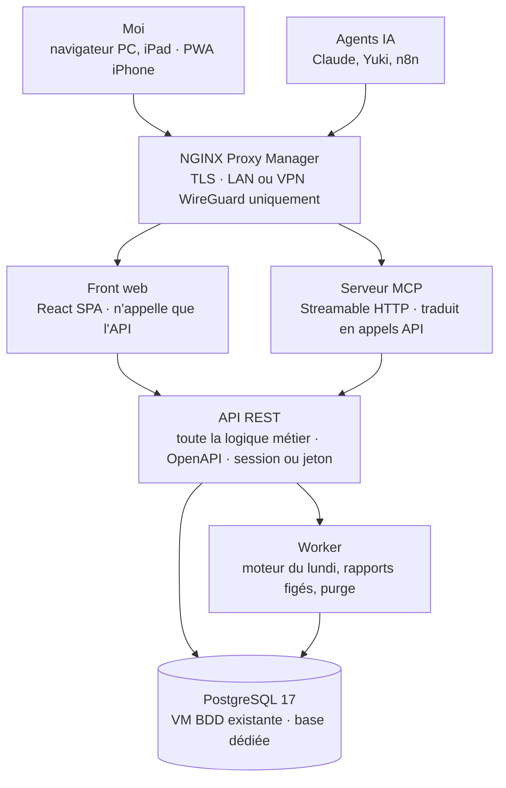
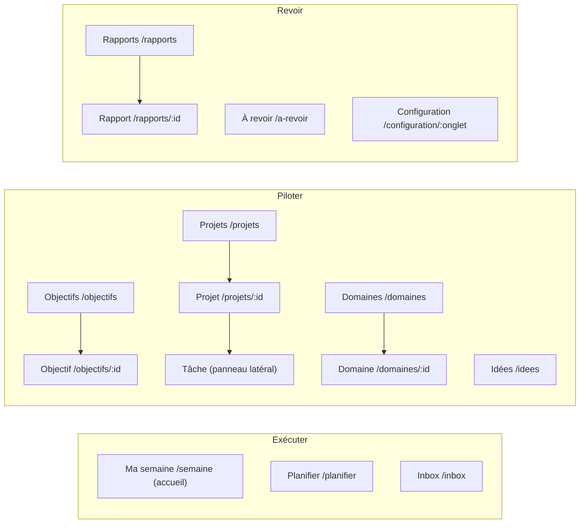

# Mémento — Dossier de dev v1

## 0. Mode d'emploi pour Claude Code

Ce dossier traduit `01-specs-fonctionnelles.md` en instructions de développement. En cas de conflit : **décisions datées (Specs §9.0) > ce dossier > maquettes > reste des Specs**.

- **IDs** : chaque règle porte l'ID des Specs (VIS, G, DM, CH, WF, R, V, F, NF) ou de ce dossier (RB). Les citer dans les commits, tests et commentaires de code.
- **Maquettes** : dossier `../maquettes/` (voir son README). Reproduire la hiérarchie visuelle et les comportements, pas le code de la maquette.
- **Nom** : l'application s'appelle **Mémento** ; identifiant technique `memento` (dépôt, packages `@memento/*`, images Docker, base, hôte).
- **Langue** : interface en français ; code, tables, endpoints et commits en anglais.
- **Règle d'or du dev** : l'API est la seule porte d'entrée de la logique métier. Le front et l'IA appellent la même API (F-26). Aucune règle métier dans le front, sauf du confort d'affichage.
- **Doute** : choisir la solution la plus simple (G-11) et l'ajouter à la liste des décisions ouvertes (§14), ne jamais inventer une règle métier silencieusement.

## 1. Périmètre v1 / v2

| Fonction | v1 | v2 |
| --- | --- | --- |
| CRUD complet : domaines, groupes, méta-objectifs, objectifs, projets / idées, tâches, Inbox, relations | Oui | |
| Promotion Idée → Projet avec contrôles (SMART, ≤ 1 mois, tâches) | Oui | |
| Ordre = prérequis, flag « libre », drag & drop | Oui | |
| Page Planifier la semaine (manuelle) + alertes en direct | Oui | |
| Moteur de proposition (score codé) : présélection + « pourquoi » | Oui | |
| Bouton « Proposer avec l'IA » | Grisé | Actif |
| Ma semaine (exécution, Bonus replié) | Oui | |
| Rapports hebdo / mensuel / trimestriel figés + historique | Oui (indicateurs codés) | Textes rédigés par l'IA (« Mes réussites », proposition trimestrielle) |
| « Mes réussites » | Projets terminés + objectifs avancés (sans IA) | Synthèse IA |
| Recherche Spotlight | Oui | |
| Filtre « À revoir » + journal IA / moi | Oui | |
| API REST + MCP (parité complète) | Oui | |
| Thèmes clair / sombre / auto | Oui | |
| iPhone | Consultation + cocher (PWA) | Saisie rapide (raccourci iOS) |
| Synchronisation calendrier | Non | À décider (Specs Q-07) |
| Notifications (rapport prêt, alertes) | À décider (Q-16) | |

## 2. Architecture

Une seule API porte toute la logique ; le front, le serveur MCP et le worker n'en contournent jamais les règles.



- **Front web** : SPA, aucun accès direct à la base. Il peut révéler des besoins d'API (endpoints d'agrégation pour un écran) : ils s'ajoutent à l'API, jamais en contournement.
- **Serveur MCP** : couche fine, chaque outil = un appel API avec un jeton IA. Aucune logique propre.
- **Worker** : même code métier que l'API (package partagé), exécute les jobs planifiés (§6, §7). File de jobs stockée dans PostgreSQL, pas de Redis.
- **Monorepo** : `apps/api`, `apps/web`, `apps/mcp`, `apps/worker`, `packages/domain` (règles métier + schémas partagés), `packages/db` (schéma et migrations).

## 3. Stack technique (proposition, à confirmer — §14)

TypeScript de bout en bout : un seul jeu de schémas partagés entre API, front, MCP et worker, donc zéro divergence entre ce que valide le front et ce que valide l'API.

| Couche | Choix proposé | Raison |
| --- | --- | --- |
| Langage | TypeScript (Node.js LTS) | Schémas partagés front / back / MCP |
| Validation | Zod (schémas dans `packages/domain`) | Une source de vérité, génère l'OpenAPI |
| API | Fastify + OpenAPI généré | Léger, typé, doc d'API automatique pour l'IA |
| ORM / migrations | Drizzle ORM | SQL lisible, migrations versionnées |
| Base | PostgreSQL 17 (VM BDD existante, base dédiée) | Déjà en place ; recherche plein texte native |
| Jobs planifiés | pg-boss (file dans PostgreSQL) | Pas de Redis à ajouter |
| MCP | SDK officiel TypeScript, transport Streamable HTTP (https://ts.sdk.modelcontextprotocol.io/) | Standard, réutilisable par Claude, Yuki, n8n |
| Front | React + Vite, TanStack Router (routes typées, fil d'Ariane), TanStack Query | Cache API, routes déclaratives |
| Drag & drop | dnd-kit | Souris et tactile (iPad) |
| Styles | Tailwind CSS sur des variables CSS de thème | Thèmes clair / sombre / auto par variables |
| Mobile | PWA (installable sur iPhone) | Pas d'app native en v1 |
| Tests | Vitest (unitaires), Playwright (bout en bout) | Standard de l'écosystème |
| Déploiement | Docker Compose, dépôt « stacks », Portainer | Identique au reste du homelab |

Versions : prendre les dernières versions stables au moment du dev ; ne pas figer ici des numéros qui vieilliront.

## 4. Modèle de données

17 tables. Toutes ont `id` (UUID), `created_at`, `updated_at`, `created_by` (`me` ou `ai:<nom du jeton>`). Suppression = statut ou archivage, jamais de suppression physique sans demande explicite.

| Table | Colonnes clés | Contraintes / notes |
| --- | --- | --- |
| `domain` | name, color_light, color_dark, priority_rank, weight, archived | Liste fermée (8 au départ, Specs §3.10). Rang unique. |
| `group` | name, domain_id | 1 seul domaine (DM-91). Nom unique, insensible à la casse. |
| `meta_objective` | title, description, horizon_date?, status | Non SMART possible (DM-17). |
| `objective` | meta_objective_id?, title, description, smart_indicator, smart_target, deadline, quarter, criticality (1-3), status | deadline obligatoire, dans le trimestre (DM-12). status : active, paused, achieved, partial, failed, abandoned. |
| `project` | title, status, objective_id?, position_in_objective, sequence_mode, primary_domain_id, success_criterion, start_date, due_date, month_flag (YYYY-MM)?, success?, last_touched_at, description | status : idea, active, paused, done, abandoned. Promotion : §5. sequence_mode : sequential (défaut) ou parallel. |
| `project_group` | project_id, group_id | N-N. Domaines du projet = domaines distincts de ses groupes, 3 max. |
| `task` | project_id? (null = Inbox), title, description, duration_min, position, is_free, is_experience, status, due_date?, recurrence_rule?, domain_id? (Inbox), postpone_count, done_at | duration_min ∈ {30, 60, 120} (DM-32). status : todo, done, cancelled. |
| `task_dependency` | task_id, depends_on_task_id | Prérequis explicites en plus de l'ordre. Pas de cycle. |
| `project_dependency` | project_id, depends_on_project_id | Idem pour les projets d'un objectif. |
| `resource_link` | owner_type, owner_id, label, url | DM-70 : objectif, projet, tâche, groupe. |
| `week_plan` | iso_week (ex. 2026-W45), status (draft, validated), budget_min, budget_reason?, validated_at | Unique par semaine. budget_min = défaut ou surcharge (CH-03). |
| `week_plan_item` | week_plan_id, task_id, kind (week, bonus), source (engine, me, ai), score?, why?, position | Unique (plan, tâche). |
| `report` | kind (week, month, quarter), period_key, generated_at, payload (jsonb), schema_version | Figé : jamais modifié après insertion (WF-08). |
| `audit_log` | at, actor, entity_type, entity_id, action, diff (jsonb), reviewed_at? | Écrit par l'API à chaque mutation (F-23). Base du filtre « À revoir » (F-25). |
| `setting` | key, value (jsonb) | Voir table des réglages. |
| `api_token` | name, token_hash, scopes, last_used_at, revoked_at? | Jetons IA (MCP, n8n). Stockés hachés. |
| `user` + `session` | login, password_hash ; session_id, expires_at | Un seul utilisateur. |

**Réglages (`setting`) et valeurs par défaut**

| Clé | Défaut | Source |
| --- | --- | --- |
| budget.weekly_min | 360 | CH-11 |
| experience.target / window_weeks | 2 / 4 | R-02 |
| experience.badge_color | #D9AE3C | V-14 |
| ideas.purge_after_months | 12 | DM-87 (à valider) |
| engine.weights | value, urgency, delay, continuity, age = 1 | §6 |
| engine.bonus_count | 3 | WF-07 |
| engine.consider_also_count | 3 | §6 |
| guards.window_weeks | 4 | CH-05 |
| schedule.week_plan | lundi 07:00 Europe/Paris | WF-01 |
| schedule.reports | lundi 07:00 ; 1er du mois ; 1er jour du trimestre | WF-01 à 03 |
| theme | auto | NF-06 |

**Données initiales (seed)** : les 8 domaines dans l'ordre Santé, Famille, Carrière, Patrimoine, Sécurité, Maison, Amis & Social, Loisirs & Découverte, avec leurs couleurs (§11), et les groupes proposés en Specs §3.10.

## 5. Règles métier exécutables

Toutes codées dans `packages/domain`, testées unitairement, appliquées par l'API. Erreur = réponse 422 avec code lisible (ex. `PROJECT_TOO_LONG`).

| ID | Règle | Contrôle |
| --- | --- | --- |
| RB-01 | Une Idée n'a besoin que d'un titre | status = idea : aucun autre champ requis (DM-85) |
| RB-02 | Promotion Idée → Actif exige : critère de succès, ≥ 1 groupe, ≥ 1 tâche, due_date − start_date ≤ 31 jours | Sinon 422 avec la liste des manques (DM-86, DM-23) |
| RB-03 | Tâche : durée ∈ {30, 60, 120} min | > 120 refusé : message « à découper » (DM-32) |
| RB-04 | Domaines d'un projet = domaines de ses groupes, 3 max ; principal ∈ cette liste, défaut = le plus prioritaire | Recalculé à chaque changement de groupes (DM-84, DM-91) |
| RB-05 | Objectif : deadline obligatoire, ≤ fin du trimestre de l'objectif | DM-12 |
| RB-06 | Disponibilité en mode séquentiel : une tâche est disponible si toutes les tâches non « libres » placées avant sont faites ou choisies dans le plan en cours | DM-51 ; mode parallel : toutes disponibles |
| RB-07 | Prérequis explicites : pas de cycle | 422 `DEPENDENCY_CYCLE` |
| RB-08 | Case « projet du mois » : seulement si le projet a des tâches, toutes avec durée | DM-93 |
| RB-09 | Tâche Expérience : ne compte ni dans le budget ni dans « Fait » | CH-12 |
| RB-10 | Report : tâche planifiée non faite en fin de semaine → reprend au plan suivant, postpone_count + 1 ; alerte à 3 | R-07 |
| RB-11 | Tâche Inbox récurrente : à sa complétion, l'occurrence suivante est créée selon recurrence_rule (iCalendar RRULE) | DM-41 |
| RB-12 | Projet terminé : « critère de succès atteint ? » oui / non → success | Réussites / échecs (WF-02) |
| RB-13 | Changer le domaine d'un projet : autorisé, journalisé ; rapports passés inchangés | DM-92 |
| RB-14 | Dépassement de budget : jamais bloquant, toujours signalé | CH-08 |
| RB-15 | Toute mutation écrit une ligne `audit_log` (acteur, diff) dans la même transaction | F-23, F-25 |
| RB-16 | Replanifier : recale les dates des projets du mois sur le réel, la barre avance / retard revient au centre ; trace conservée | DM-93 |

## 6. Moteur de proposition du lundi

Déterministe : mêmes données = même proposition (Specs Q-25). Il prépare la page « Planifier la semaine » : il **présélectionne et classe**, je choisis. Exécuté par le worker chaque lundi à l'heure réglée, et à la demande (`POST /week-plans/{week}/propose`).

**Étapes**

1. **Candidats** : tâches status = todo, disponibles (RB-06, RB-07), dont le projet est actif, ou tâches Inbox. Exclure projets en pause et idées.
2. **Obligatoires** : tâches dont due_date ≤ dimanche de la semaine, marquées « deadline » et pré-cochées.
3. **Score** de chaque candidate (formule ci-dessous).
4. **Groupes de la page, dans cet ordre** : Inbox (tâches Inbox candidates, triées deadline puis score) ; Projets du mois (month_flag = mois courant) ; À considérer aussi (autres projets actifs, top N par meilleur score, N = 3 par défaut).
5. **Tâches visibles par projet** : les k premières disponibles dans l'ordre (min 1, max 3, selon la part de budget) ; la suivante apparaît quand toutes les visibles sont choisies ; « + N autres tâches » déplie le reste en lecture seule (V-16).
6. **Pré-cochage** : aucune tâche cochée d'office en v1, sauf les obligatoires. En v2, le bouton IA remplit la sélection.
7. **Pourquoi** : une ligne par tâche, issue de la composante dominante du score (ex. « Objectif X en retard de 2 h », « Deadline jeudi », « Reportée 3 fois », « Expériences : 0 / 2 sur 4 semaines »).
8. **Bonus** : les 3 suivantes au score parmi les projets retenus, proposées en « Bonus » (WF-07).

**Score**

```
Score = (wv·V + wu·U + wr·R + wc·C + wa·A) / D
```

| Terme | Calcul (0 à 1 sauf D) |
| --- | --- |
| V valeur | poids du domaine principal + 50 % du poids des autres domaines prioritaires (DM-84), × criticité de l'objectif / 3 ; projet sans objectif : × 1/3 |
| U urgence | 1 si deadline ≤ 7 j, décroissance linéaire jusqu'à 0 à 30 j |
| R retard | (heures prévues à date − heures faites) ÷ heures du projet, borné [0, 1], projets du mois seulement |
| C continuité | 1 si le projet a eu une tâche faite les 2 dernières semaines (finir avant d'ouvrir) |
| A âge | postpone_count ÷ 3, borné à 1 |
| D durée | durée en heures (0,5 ; 1 ; 2), inspiré du WSJF (coût du délai ÷ durée) |

Poids par défaut w = 1, réglables (V-14). Garde-fous (CH-05) : si Santé ou Famille ont 0 h sur `guards.window_weeks`, leurs projets montent en tête de « À considérer aussi ».

**Alertes en direct sur la page** : dépassement de budget (avec le montant, non bloquant), Santé vide, Famille vide, 0 expérience prévue ; sinon « Rien à signaler ».

## 7. Rapports

Générés par le worker, stockés en `report.payload` (jsonb) et **jamais recalculés** (WF-08). L'écran lit uniquement le payload.

| ID | Indicateur | Calcul exact | Affichage |
| --- | --- | --- | --- |
| R-01 | Indicateur global | Rouge si 0 expérience ET 0 h Santé ; vert si R-02 ≥ cible au prorata, Santé et Famille > 0 h, R-05 = OK, R-04 = Cap tenu ; sinon orange. Seuils réglables | Pastille 3 couleurs + titre + 1 phrase |
| — | Mes réussites | v1 : projets terminés avec succès + objectifs dont l'avancement a progressé. v2 : synthèse IA (tâches regroupées en résultats, seul ce qui compte, pas de quota) | Juste sous l'indicateur global ; 1 phrase + domaine + nb de tâches |
| R-08 | Tâches terminées | Nb de tâches faites (dont bonus) + valeur semaine précédente | Nombre brut, sans couleur, hors indicateur global |
| R-02 | Expériences | Nb de tâches is_experience faites sur `experience.window_weeks` | « x / cible » |
| R-04 | Focus | Heures faites hors expériences : objectifs actifs ≥ 50 % → Cap tenu ; Inbox ≥ 50 % → Semaine Inbox (neutre) ; hors objectif ≥ 50 % → Dispersé ; sinon Mixte | Palier en texte, jamais de % |
| R-05 | Rythme | heures faites ÷ budget : < 80 % Sous-productif ; 80 à 110 % OK ; > 110 % Surproductif | Palier en texte |
| R-07 | Évitement | Tâches avec postpone_count ≥ 3 | Nombre + titres |
| R-06 | Avance / retard | Par projet du mois : heures prévues à date (prorata des jours écoulés) − heures faites | Barre centrée, ± heures |
| — | Heures par domaine | Durées des tâches faites par domaine, expériences incluses, ordre de priorité | Barres |

Ordre d'affichage du rapport hebdo (maquette `rapport-hebdo.dc.html`) : en-tête + navigation (semaine précédente, Mois, Trimestre) → indicateur global → Mes réussites → tuiles (Tâches terminées, Expériences, Focus, Rythme, Évitement) → Avance / retard + Heures par domaine.

**Mensuel** : agrégats des semaines + tendance ; projets terminés (succès / échec) ; journal des expériences du mois ; nb de semaines en dépassement ; idées créées / promues / purgées ; 3 idées remontées (DM-90).

**Trimestriel** : objectifs atteints / partiels / ratés ; avancement des méta-objectifs ; écart priorités déclarées / heures réelles par domaine ; journal des expériences ; v2 : proposition IA (reconduire, ajuster, arrêter).

**Payload** : `schema_version` + toutes les valeurs affichées déjà calculées (pas d'identifiants à résoudre au rendu, sauf les liens vers les fiches).

## 8. API REST

Préfixe `/api/v1`, JSON, contrat OpenAPI généré depuis les schémas Zod et servi sur `/api/v1/openapi.json`. Auth : cookie de session (front) ou `Authorization: Bearer <jeton>` (IA). Pagination par curseur ; filtres en query string.

| Ressource | Endpoints | Notes |
| --- | --- | --- |
| Domaines | GET/POST /domains, PATCH /domains/{id}, POST /domains/reorder | Archivage, pas de suppression |
| Groupes | GET/POST /groups, PATCH/DELETE /groups/{id} | DELETE refusé si projets rattachés |
| Méta-objectifs | CRUD /meta-objectives | |
| Objectifs | CRUD /objectives, GET /objectives/{id}/path | path = chemin ordonné des projets (V-02) |
| Projets / idées | CRUD /projects, POST /projects/{id}/promote, POST /projects/{id}/complete, PUT /projects/{id}/groups, POST /projects/reorder | promote applique RB-02 ; complete applique RB-12 |
| Tâches | CRUD /tasks, POST /tasks/{id}/complete, POST /tasks/{id}/uncomplete, POST /tasks/reorder, POST /tasks/{id}/move | project_id null = Inbox |
| Dépendances | POST/DELETE /tasks/{id}/dependencies, POST/DELETE /projects/{id}/dependencies | RB-07 |
| Ressources | POST/DELETE /resources | |
| Planification | GET /week-plans/{iso_week}, POST /week-plans/{iso_week}/propose, PUT /week-plans/{iso_week}/items, PATCH /week-plans/{iso_week} (budget), POST /week-plans/{iso_week}/validate | GET renvoie la page prête à afficher : groupes, tâches visibles, pourquoi, budget, répartition, alertes |
| Ma semaine | GET /weeks/{iso_week}/execution | Tâches du plan + Bonus + indicateurs live |
| Rapports | GET /reports?kind=&from=&to=, GET /reports/{id}, POST /reports/generate | Lecture seule ensuite |
| Recherche | GET /search?q= | Résultats groupés par type |
| À revoir | GET /changes?since=&actor=, POST /changes/mark-reviewed | F-25 |
| Réglages | GET/PATCH /settings | V-14 |
| Jetons | GET/POST/DELETE /tokens | Valeur affichée une seule fois |

Les endpoints « page prête » (planification, exécution) existent parce que le front en a besoin : c'est le front qui façonne le back. Ils restent dans l'API, donc l'IA y a accès aussi.

## 9. Serveur MCP

Outils nommés en anglais, description en français, chacun = un ou deux appels API. Le serveur s'authentifie avec un jeton IA dédié : toute action IA est journalisée « ai:<nom> » et visible dans « À revoir ».

| Outil | Rôle |
| --- | --- |
| `search` | Recherche globale |
| `get_context` | Vue d'ensemble : domaines, objectifs actifs, projets du mois, budget, alertes |
| `list_objectives`, `get_objective` | Avec chemin des projets |
| `create_objective`, `update_objective` | |
| `list_projects`, `get_project` | Filtres : statut, groupe, domaine, mois |
| `create_idea`, `create_project`, `update_project`, `promote_idea`, `complete_project` | promote applique RB-02 et renvoie les manques |
| `create_tasks` (lot), `update_task`, `complete_task`, `reorder_tasks` | Création en lot pour découper un projet |
| `add_inbox_task` | Capture rapide |
| `get_week_plan`, `propose_week_plan`, `set_week_plan_items` | Base du bouton IA en v2 |
| `get_report`, `list_reports` | Lecture des rapports figés |
| `list_changes` | Ce qui a changé (F-25) |
| `add_resource` | Lien vers la doc (DM-70) |

Pas d'outil de suppression définitive ni de réglages : réservés à l'interface.

## 10. Arborescence des pages et fil d'Ariane

Trois espaces ; l'accueil est « Ma semaine ». Barre latérale sur PC et iPad, barre d'onglets en bas sur iPhone (Semaine, Projets, Idées, Rapports). Recherche partout (Cmd+K).



| Page | URL | Fil d'Ariane | Contenu | Maquette |
| --- | --- | --- | --- | --- |
| Ma semaine | /semaine | Ma semaine | Exécution : tâches du plan, Bonus replié, budget, projets du mois (avance / retard), domaines | ma-semaine.dc.html, ma-semaine-iphone.dc.html |
| Planifier | /planifier?semaine=2026-W45 | Planifier › Semaine 45 | 3 bacs (Inbox, Projets du mois, À considérer aussi), budget, alertes, répartition, bouton IA grisé | planifier-la-semaine.dc.html |
| Inbox | /inbox | Inbox | Tâches hors projet, deadlines, récurrences, capture rapide | — |
| Objectifs | /objectifs | Objectifs | Méta-objectifs et objectifs du trimestre, interactions (V-01) | — |
| Objectif | /objectifs/:id | Objectifs › [Méta] › Objectif | Chemin : projets ordonnés et prérequis (V-02), SMART, deadline, description | — |
| Projets | /projets | Projets | Arborescence Domaine › Groupe › Projet ; vues liste et kanban (V-04, V-05) ; filtres statut, mois | — |
| Projet | /projets/:id | Projets › Domaine › Groupe › Projet | Tâches dans l'ordre, verrous, critère de succès, ressources, case « projet du mois » | — |
| Tâche | panneau latéral, /projets/:id?tache=:tid | … › Projet › Tâche | Titre, description, durée, Expérience, libre, deadline, récurrence, ressources | — |
| Domaines | /domaines, /domaines/:id | Domaines › Domaine | Tous les projets du domaine, connexes atténués + liseré de leur domaine principal (V-15) | — |
| Idées | /idees | Idées | Filtres domaine / groupe, tri par ancienneté, promotion en 1 action (DM-90) | — |
| Rapports | /rapports, /rapports/:id | Rapports › Hebdo › S43 | Historique, rapports figés, navigation précédent / suivant | rapport-hebdo.dc.html |
| À revoir | /a-revoir | À revoir | Créations et modifications récentes, filtre période / auteur, « marquer comme revu » (F-25) | — |
| Configuration | /configuration/:onglet | Configuration › Onglet | Budget, Domaines, Groupes, Moteur, Alertes, Planning, Templates, Accès (V-14) | — |

**Fil d'Ariane** : toujours affiché sous l'en-tête, chaque segment est un lien (G-12). Projet multi-groupes : groupe principal affiché.

**Pages sans maquette** : réutiliser les composants des maquettes (cartes, lignes de tâche, bacs, pastilles de domaine), sans inventer de style.

## 11. Design system et composants

Valeurs claires = maquettes validées (NF-07). Valeurs sombres = proposition à valider à l'écran. Toutes en variables CSS ; thème `auto` suit `prefers-color-scheme`, `clair` / `sombre` forcent (NF-06).

**Typographie** : IBM Plex Sans (texte), IBM Plex Mono (chiffres, durées). Titres 34 / 21 / 18 px, texte 15-16 px, méta 12-13 px.

| Jeton | Clair | Sombre (proposé) |
| --- | --- | --- |
| --bg | #F6F6F3 | #121211 |
| --surface (cartes) | #FFFFFF | #1C1C1A |
| --bin (bacs de groupe) | #EFEFEA | #171715 |
| --border | #E6E6E1 | #2E2E2B |
| --text | #1A1A1A | #F2F2EE |
| --text-muted | #5F5F5A | #B5B5AE |
| --late (retard) | barre #E0A27A, texte #9A4A17 | barre #B9784F, texte #F0B08A |
| --ahead (avance) | barre #8FB3E8, texte #2456A8 | barre #5D86C4, texte #A9C6F2 |
| --warn (alertes) | #E08A2E | #F0A04B |
| --ok | #2F7A55 | #5CC08D |
| --experience (badge or) | #D9AE3C (réglable) | identique, texte #3B2C05 |

| Domaine | Clair | Sombre (proposé) |
| --- | --- | --- |
| Santé | #2F8F62 | #4FBF8A |
| Famille | #D2691E | #F0954B |
| Carrière | #2F6FDB | #6A9BF2 |
| Patrimoine | #A47A12 | #D4A93A |
| Sécurité | #6B5BC4 | #9A8CF0 |
| Maison | #8A6448 | #B88E6E |
| Amis & Social | #B8487A | #E07AA6 |
| Loisirs & Découverte | #1F8A9C | #4CC0D3 |
| Inbox | #7A7A75 | #9A9A94 |

**Règles visuelles** : couleur de domaine en pastille et case à cocher uniquement (G-08) ; pas de dégradé sauf le badge Expérience ; contraste texte ≥ 4,5:1 ; cible tactile ≥ 44 px sur iPad / iPhone ; liens d'entité sans style de lien, soulignés au survol (G-12) ; focus clavier toujours visible.

**Composants** : AppShell (barre latérale / onglets bas), Breadcrumb, SearchPalette (Cmd+K), EntityLink, DomainDot, TaskRow (case, titre, pourquoi, durée, badges Expérience et Bonus, verrou), ProjectCard, GroupBin, BonusDrawer (replié par défaut, état non mémorisé), BudgetGauge, DelayBar (centrée), DomainBars, AlertList, KpiTile, ReportHero, TaskDrawer, KanbanBoard, ListTable, ObjectivePath, ThemeSwitch, Toast.

## 12. Recherche, sécurité, journal, sauvegardes, déploiement

**Recherche (F-01 à F-04)**

- PostgreSQL plein texte, configuration `french`, poids : titre = A, groupes et domaines = B, description = C. Tolérance aux fautes : extension `pg_trgm` sur les titres.
- Classement : titre exact, puis début de titre, puis rang plein texte ; résultats groupés par type (Objectifs, Projets, Idées, Tâches, Inbox), 5 par type, popup au fil de la frappe (debounce 150 ms).

**Sécurité**

- Un seul utilisateur : mot de passe haché (argon2id), cookie de session httpOnly, Secure, SameSite=Strict.
- Jetons IA : générés dans Configuration › Accès, stockés hachés, révocables, portée lecture ou lecture-écriture.
- Aucune exposition Internet : accès LAN ou VPN WireGuard (iPhone hors de la maison). Limitation de débit sur la connexion.
- Secrets (mot de passe BDD, clé de session) en variables d'environnement injectées au déploiement, jamais dans le dépôt.

**Journal (F-23)** : `audit_log` écrit dans la même transaction que la mutation. Rétention illimitée en v1.

**Sauvegardes** : `pg_dump` quotidien de la base dédiée vers le NAS, rétention 30 jours ; test de restauration documenté dans le README.

**Déploiement homelab**

- 4 images Docker : `api`, `worker`, `mcp`, `web` (statique derrière un nginx léger). Un `docker-compose.yml` dans le dépôt « stacks », déployé par Portainer (mode Repository).
- Base : nouvelle base + utilisateur dédiés sur la VM PostgreSQL 17 existante. Migrations Drizzle appliquées au démarrage de `api`.
- NGINX Proxy Manager : un hôte interne (nom à choisir, ex. `memento.internal.lcl`), `/` → web, `/api` → api, `/mcp` → mcp.
- Healthchecks sur chaque conteneur ; logs JSON sur la sortie standard (Graylog possible via le pilote de logs Docker).
- Fuseau : Europe/Paris pour le worker.

## 13. Plan de développement et critères d'acceptation

8 lots, dans l'ordre. Chaque lot se termine par ses tests verts et une démo ; **Claude Code s'arrête à la fin de chaque lot pour validation.**

| Lot | Contenu | Critères d'acceptation |
| --- | --- | --- |
| L0 Socle | Monorepo, lint, tests, Docker Compose de dev, schéma + migrations, connexion, `audit_log`, réglages, seed des 8 domaines | Connexion OK ; migrations rejouables à vide ; 8 domaines dans l'ordre |
| L1 API référentiel | CRUD de toutes les entités, promotion, dépendances, réordonnancement, OpenAPI | RB-01 à RB-08 et RB-11 à RB-15 testés ; promouvoir une idée sans tâche renvoie 422 avec la liste des manques |
| L2 Front référentiel | AppShell, fil d'Ariane, Projets (arbo, liste, kanban), Projet, Tâche (panneau), Objectifs, Objectif (chemin), Idées, Inbox, Domaines, recherche Cmd+K, thèmes, drag & drop | Toutes les actions de l'API faisables à la main (F-26) ; réordonner change la disponibilité (RB-06) ; contraste et thèmes OK |
| L3 Planification | Moteur §6, endpoint « page prête », page Planifier | Même données = même proposition ; tâches suivantes révélées ; alertes en direct ; dépassement non bloquant ; conforme à planifier-la-semaine.dc.html |
| L4 Exécution | Ma semaine desktop + PWA iPhone, Bonus replié, reports | Cocher met à jour Fait ; Bonus jamais déplié par défaut ; Expériences hors budget (RB-09) ; fin de semaine : non faites reportées, compteur + 1 |
| L5 Rapports | Jobs hebdo, mensuel, trimestriel ; pages Rapports | Modifier une tâche après génération ne change pas le rapport ; historique navigable ; conforme à rapport-hebdo.dc.html |
| L6 IA | Serveur MCP, jetons, page À revoir | Un outil MCP crée une tâche visible dans À revoir avec l'auteur ai:<jeton> ; « marquer comme revu » la retire |
| L7 Mise en service | Compose de prod, NPM, sauvegarde quotidienne, README d'exploitation | Restauration testée ; accès iPhone via VPN ; aucun port exposé sur Internet |

**Définition de « terminé »** : tests unitaires des règles touchées, test bout en bout du parcours principal, pas d'erreur console, écran utilisable en 1280 px, largeur iPad et largeur iPhone.

## 14. Templates par défaut et décisions encore ouvertes

**Templates de description (G-10), modifiables en Configuration**

| Élément | Rubriques |
| --- | --- |
| Méta-objectif | Ce que je veux dans ~1 an · Pourquoi ça compte vraiment · À quoi je verrai que c'est atteint |
| Objectif | Résultat attendu (SMART) · Pourquoi en surface · Pourquoi profond · Comment je mesure · Ce que je ne fais pas |
| Projet | Résultat attendu en 1 phrase · Critère de succès (oui / non) · Contexte en 2 lignes · Ressources |
| Tâche | Quoi faire, concrètement · Où / avec quoi (lien) |

**À trancher avant de lancer le dev** (L0 à L2 peuvent démarrer avec les valeurs proposées)

- [ ] Stack §3 validée (TypeScript, Fastify, Drizzle, React, pg-boss)
- [ ] Nom d'hôte interne (ex. memento.internal.lcl)
- [ ] Couleurs du thème sombre §11 à valider à l'écran
- [ ] Délai de purge des idées : 12 mois ?
- [ ] Canal des rapports et alertes : dans l'outil seulement, ou aussi mail / notification / Yuki (Specs Q-16)
- [ ] Calendrier : lecture de l'agenda en v2 ou jamais (Specs Q-07)
- [ ] « Interactions entre objectifs » de la vue d'ensemble : prérequis, conflit de temps ou contribution (Specs Q-09)
- [ ] Kanban : colonnes globales Cette semaine / En cours / En attente / Fait (Specs Q-11)
- [ ] Import des données Vikunja existantes : oui (script en L7) ou départ à zéro
- [ ] Rattachement des groupes « Outils perso » (Santé) et « Travaux » (Maison) confirmé
